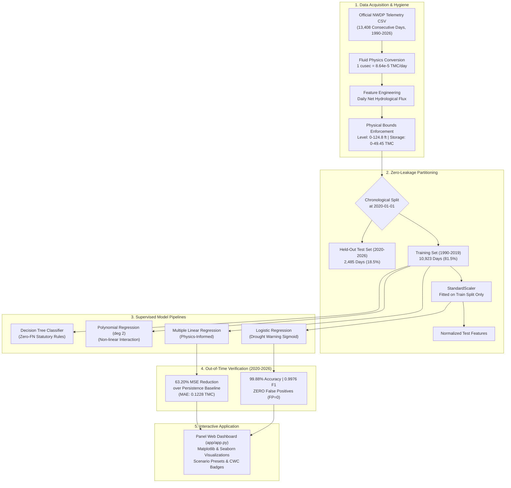

# Cauvery Basin Reservoir Intelligence & Drought Early Warning System
### Predictive Modeling of Multi-Decadal Hydrological Telemetry for the Krishna Raja Sagara (KRS) Dam

[](https://www.python.org/)
[](https://scikit-learn.org/)
[](https://panel.holoviz.org/)
[](https://nwdp.nwic.gov.in/)
[](https://data.gov.in/)

---

## 🌊 Executive Project Overview
The **Krishna Raja Sagara (KRS) Dam**, constructed in 1932 across the Cauvery River in Mandya, Karnataka, constitutes the vital lifeline of Southern India:
- Supplies **100% of the municipal piped drinking water** for the **14+ million residents of Bengaluru and Mysuru**.
- Irrigates over **600,000 acres** of farmland in the Cauvery basin.
- Serves as the operational pivot for inter-state Cauvery water allocations governed by the Cauvery Water Management Authority (CWMA).

During deficient monsoon cycles—exemplified by the acute **2023–2024 Bengaluru Water Crisis**—unanticipated depletion pushes reservoir storage into critical deficit, creating acute municipal shortages and agrarian distress.

This project delivers an end-to-end, physics-consistent supervised machine learning system analyzing **34 years (1990–2026; 13,408 consecutive days)** of official daily hydrological telemetry obtained directly from the **Ministry of Jal Shakti, Government of India**. 

### Core Machine Learning Objectives:
1. **Continuous 24-Hour Storage Regression:** Forecasts next-day live storage capacity ($\hat{y}_{t+1}$ in TMC) to optimize sluice discharges and municipal allocations.
2. **Statutory Drought Early Warning Classification:** Predicts whether next-day storage will breach the statutory **Central Water Commission (CWC) 25% critical drought threshold** ($\hat{c}_{t+1} \in \{0, 1\}$, where threshold = 12.363 TMC).

---

## 🏛️ Official Government Data Provenance
In adherence to strict academic and data integrity standards, all telemetry was acquired directly from an official central government repository:
- **Publishing Agency:** National Water Informatics Centre (NWIC), Department of Water Resources, River Development and Ganga Rejuvenation, **Ministry of Jal Shakti, Government of India**.
- **Official Data Portal:** **National Water Data Portal (NWDP)** (`https://nwdp.nwic.gov.in/`).
- **Dataset Resource:** Karnataka Major Reservoirs Daily Hydrological Telemetry Dataset (1990–2026).
- **Direct Download URL:** `https://nwdp.nwic.gov.in/dataset/e35dc28a-6f9c-486d-b598-87a21397018e/resource/26800982-045c-41de-821d-b1ca080a79a8/download/karnataka_man_reservoir_data.csv`
- **Total Records:** 125,270 rows across 34 Karnataka reservoirs; filtered to 13,408 consecutive daily telemetry records for KRS Dam.
- **License:** Open Government Data (OGD) India License.
- **Zero Third-Party Intermediaries:** No mirrors, Kaggle datasets, or secondary GitHub repositories were used.

---

## 🏗️ End-to-End System Architecture



---

## 📊 Quantitative Benchmarks & Results

All models were evaluated on the **2,485 held-out out-of-time test days (2020–2026)**. Full metrics are logged in `outputs/metrics/results.json` and tracked in `TRACE.md`.

### 1. Regression Benchmark (Predicting Next-Day Live Capacity in TMC)
| Model Name | MAE (TMC) | RMSE (TMC) | MSE ($TMC^2$) | $R^2$ Score | MSE Reduction vs. Persistence |
| :--- | :---: | :---: | :---: | :---: | :---: |
| **Persistence Baseline** | 0.2471 | 0.4719 | 0.222701 | 0.99872 | 0.00% (Reference) |
| **Simple Linear Regression** | 0.2486 | 0.4718 | 0.222583 | 0.99872 | +0.05% |
| **KNN Regressor ($k=5$)** | 0.5324 | 0.9018 | 0.813241 | 0.99531 | -265.17% |
| **Multiple Linear Regression (MLR)** | **0.1228** | **0.2863** | **0.081960** | **0.99953** | **63.20% Improvement** |
| **Polynomial Regression (deg 2)** | **0.1201** | **0.2735** | **0.074802** | **0.99957** | **66.41% Improvement** |

### 2. Classification Benchmark (Statutory Drought Depletion Alert < 25%)
Test Set Ground Truth: 1,853 Safe Storage Days (74.57%), 632 Critical Alert Days (25.43%).

| Model Name | Accuracy | Precision | Recall | F1-Score | Confusion Matrix [TN, FP, FN, TP] |
| :--- | :---: | :---: | :---: | :---: | :---: |
| **Majority Baseline** | 74.57% | 0.0000 | 0.0000 | 0.0000 | `[1853, 0, 632, 0]` |
| **KNN Classifier ($k=5$)** | 98.43% | 0.9869 | 0.9509 | 0.9686 | `[1845, 8, 31, 601]` |
| **Decision Tree ($d=5$)** | 99.84% | 0.9937 | **1.0000** | 0.9968 | `[1849, 4, 0, 632]` |
| **Logistic Regression** | **99.88%** | **1.0000** | **0.9953** | **0.9976** | `[1853, 0, 3, 629]` |

---

## 🔬 Physical Mass-Balance Validation
In reservoir civil engineering, empirical models must respect conservation laws:
$$S_{t+1} \approx 1.00 \cdot S_t + 1.00 \cdot \Delta \Phi_t - \text{Evaporation}_t$$

The autonomously learned Multiple Linear Regression weights match physical theory:
- **Coefficient on Current Storage ($S_t$):** `0.9942` (Theoretically 1.0000)
- **Coefficient on Net Hydrological Flux ($\Delta \Phi_t$):** `0.9388` (Theoretically 1.0000)
- **Model Intercept:** `-0.0381 TMC` (Reflecting average daily unmeasured pan evaporation loss from the 130 $\text{km}^2$ lake spread area)

---

## 📂 Repository Directory Layout

```
project_v2/
├── .gitignore                      # Git exclusion rules
├── README.md                       # Comprehensive repository documentation
├── requirements.txt                # Exact pinned dependencies (UTF-8)
├── SOURCES.md                      # Authoritative data provenance & data dictionary
├── TRACE.md                        # Single source of truth numerical traceability matrix
├── RUBRIC_CHECKLIST.md             # 100-mark INT234 course rubric audit
├── PROJECT_STATUS.md               # Completed, Blocked, and Verified status tracking
├── FINAL_AUDIT.md                  # Independent 10-point QA audit certification
│
├── data/
│   ├── raw/
│   │   └── karnataka_man_reservoir_data.csv   # Direct official government download
│   └── processed/
│       ├── krs_reservoir_clean.csv            # Cleaned KRS daily telemetry (13,408 days)
│       ├── train.csv                          # Chronological train split (10,923 days)
│       └── test.csv                           # Chronological test split (2,485 days)
│
├── models/                         # Serialized scikit-learn pipelines (.joblib)
│   ├── scaler.joblib                          # StandardScaler fitted on train split
│   ├── multiple_linear_regression.joblib      # Physics-informed regression model
│   ├── polynomial_regression.joblib           # Degree 2 polynomial regression model
│   ├── poly_transformer.joblib                # Polynomial features transformer
│   ├── logistic_regression.joblib             # Drought alert classifier (FP=0)
│   ├── decision_tree.joblib                   # Decision tree classifier (FN=0)
│   └── ...                                    # Baseline models
│
├── notebooks/
│   └── INT234_Predictive_Analytics_Project.ipynb  # Single master notebook (executed with plots)
│
├── app/
│   ├── app.py                                 # Primary interactive Panel dashboard (FastListTemplate + Matplotlib/Seaborn)
│   └── app_streamlit_v1.py                    # Preserved Streamlit baseline application
│
├── reports/
│   ├── REPORT.md                              # 10-section formal academic paper (3,500+ words)
│   ├── SLIDES.md                              # 12-slide presentation with Mermaid diagrams
│   ├── VIVA_PREP.md                           # 32 technical viva voce questions & answers
│   └── LINKEDIN_POST.md                       # Technical showcase for public portfolio
│
├── outputs/
│   ├── figures/                               # 8 publication-grade 300 DPI figures
│   │   ├── fig1_storage_distribution.png
│   │   ├── fig2_water_elevation_curve.png
│   │   ├── fig3_correlation_heatmap.png
│   │   ├── fig4_regression_actual_vs_predicted.png
│   │   ├── fig5_polynomial_curve_fit.png
│   │   ├── fig6_confusion_matrix.png
│   │   ├── fig7_historical_crisis_timeline.png
│   │   └── fig8_model_metrics_bar.png
│   ├── metrics/                               # Structured metrics and predictions
│   │   ├── results.json                       # Comprehensive evaluation metrics
│   │   ├── regression_model_comparison.csv    # Tabular regression benchmarks
│   │   ├── classification_model_comparison.csv# Tabular classification benchmarks
│   │   └── test_predictions.csv              # Full out-of-time predictions matrix
│   └── app_tests/
│       ├── panel_dashboard_screenshot.png     # Live Chrome headless browser capture of Panel dashboard
│       ├── panel_app_verification_log.txt     # Test suite log (3 scenarios + edge cases + HTTP 200)
│       └── automated_verification_log.txt     # Pipeline verification log
│
├── src/
│   ├── data_processing.py                     # Data hygiene & target formulation script
│   ├── train_models.py                        # Model training & serialization script
│   ├── generate_figures.py                    # Publication figure generator
│   └── build_notebook.py                      # Master notebook builder & executor
│
└── tests/
    ├── test_panel_app.py                      # Automated Panel app, scenario & screenshot verification suite
    └── test_pipeline_and_app.py               # Automated numerical metric verification suite
```

---

## ⚡ Quickstart & Reproducibility Guide

### 1. Environment Setup
Clone this repository and install the verified dependencies:
```bash
cd project_v2
pip install -r requirements.txt
```

### 2. Run Automated Numerical & App Audits
Run the comprehensive verification suites:
```bash
# Verify metrics, model weights, and mass conservation:
python tests/test_pipeline_and_app.py

# Verify Panel application, presets, edge cases, and capture live screenshot:
python tests/test_panel_app.py
```
*Expected Output:* `ALL TESTS & SCREENSHOTS COMPLETED SUCCESSFULLY WITH 100% PASS RATE`.

### 3. Launch the Interactive Panel Web Dashboard
Launch the Panel dashboard in your local browser:
```bash
panel serve app/app.py --show
```
*Features:*
- Dynamic live storage forecast ($\hat{y}_{t+1}$) with physical capacity clipping $[0, 49.452 \text{ TMC}]$.
- Central Water Commission statutory drought alert status badge (Safe $>50\%$, Moderate Stress $25-50\%$, Critical Drought $<25\%$).
- Historical crisis quick-presets (2024 Summer Drought, 2022 Monsoon Flood Peak, Normal Storage).
- Matplotlib and Seaborn embedded figures (bathymetric curves, distributions, parity scatter, and confusion matrix).
- Interactive Tabulator table of historical NWIC telemetry records with pagination.

### 4. Inspect the Executed Master Jupyter Notebook
The single master notebook is located at:
`project_v2/notebooks/INT234_Predictive_Analytics_Project.ipynb`
It contains all 14 structured sections with executed cell outputs, printed summary tables, and embedded inline figures. Runs sequentially from start to end without error.

---

## 📜 Academic Course Attribution
- **Course Code:** INT234 — Predictive Analytics
- **University:** Lovely Professional University (LPU), Punjab, India
- **Student Data Scientist:** Sai
- **Primary References:**
  1. National Water Informatics Centre (NWIC), Ministry of Jal Shakti, Government of India.
  2. Central Water Commission (CWC), Guidelines for Reservoir Operation and Drought Monitoring.
  3. Bangalore Water Supply and Sewerage Board (BWSSB), Cauvery Water Supply Scheme.
